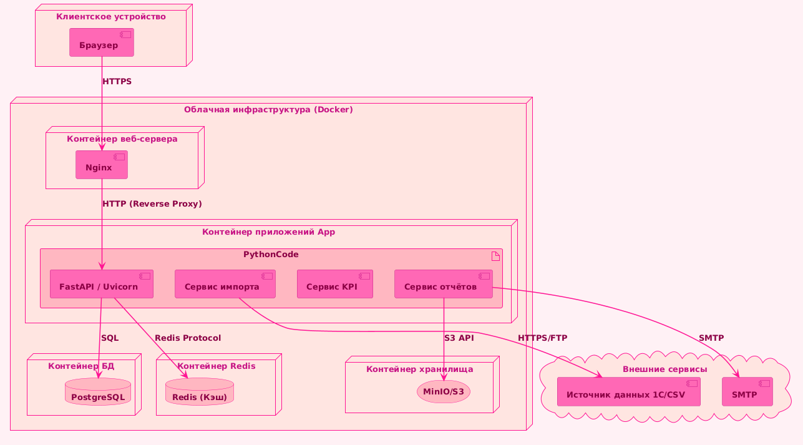

## 4 Диаграммы
### 4.3 Диаграмма развёртывания
#### 4.3.1 Физическая топология развёртывания
* клиентские устройства (браузер);
* веб-сервер (Nginx / reverse proxy);
* контейнер приложения (FastAPI + Uvicorn);
* контейнер БД PostgreSQL;
* контейнер Redis (кэш);
* хранилище отчётов (MinIO/S3);
* внешние сервисы (SMTP, источник данных);

#### 4.3.2 Диаграмма развёртывания

#### 4.3.3 Описание узлов

| Узел | Образ ПО | CPU | RAM | Назначение |
|---|---|---|---|---|
| Nginx | nginx:alpine | 0.5 CPU | 256 MB | Reverse proxy, TLS, защита от DDoS |
| App-Server | bma-api:latest (python:3.10-slim) | 1.0 CPU | 1 GB | Среда Python (FastAPI + Uvicorn). Расчет KPI, импорт данных, логика отчетов |
| PostgreSQL | postgres:16 | 2.0 CPU | 2 GB | Основная реляционная СУБД для хранения коммерческих и системных данных |
| Redis | redis:7-alpine | 0.5 CPU | 512 MB | Кэш в оператичной памти для мгновенного доступа к рассчитанным метрикам KPI |
| MinIO/S3 | minio/minio | 0.5 CPU | 512 MB | S3-совместимое объектное хранилище для отчётов PDF/Excel отчеты |