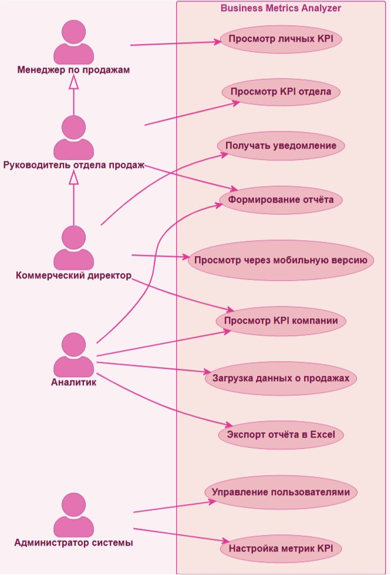

# Бизнес-требования к учебному приложению business metrics analyzer

## 1. Необходимость
Приложение помогает быстро считать основные показатели бизнеса: выручку, среднюю выручку и рентабельность.

## 2. Проблема
Считать KPI вручную долго и легко ошибиться. Приложение автоматизирует расчёты.

## 3. Цели
- автоматически считать базовые KPI;
- сделать код простым, чтобы потом можно было добавить новые метрики.

## 4. Что должно делать приложение
- принимать данные о выручке и затратах по месяцам;
- считать среднюю выручку;
- считать рентабельность;
- выводить результаты в консоль.

## 5. Интсрументы реализации
- Python 3.10+;
- библиотеки pandas.

## 6. Критерии успеха
- KPI считаются правильно;
- приложение запускается и показывает результаты;
- в Git есть ветки, коммиты и Pull Request;
- есть файл README.md.

## Use Case

| Поле | Значение |
|:---:|:---:|
| Название | Формирование отчёта по KPI |
| Актор | Аналитик (также коммерческий директор, руководитель отдела) |
| Предусловие | Пользователь авторизован, данные о продажах за период загружены |
| Основной поток | 1. Пользователь открывает раздел «Отчёты». 2. Указывает период и при необходимости фильтры: отдел, торговая точка, менеджер. 3. Нажимает «Сформировать». 4. Система рассчитывает выручку, средний чек, конверсию, рентабельность, количество новых клиентов и продажи по категориям. 5. Система отображает отчёт в виде графиков с таблицей (не более 15 с). 6. Пользователь просматривает отчёт |
| Альтернативный поток | 4а. Если данных за выбранный период нет — система выводит сообщение «За выбранный период данных нет», отчёт не формируется. 5а. Если пользователь — руководитель отдела, отчёт строится только по его отделу, рентабельность не отображается. |
| Расширение  | 7а. Пользователь нажимает «Экспорт в Excel» |
| Постусловие | Отчёт сформирован и доступен для просмотра и экспорта |

## Описание бизнес-процесса «как есть» (AS-IS)

1. Выгрузка данных из 1С
* В конце дня сотрудник выгружает данные о продажах из 1С.
* Сотрудник передаёт данные руководителю отдела

2. Составление сводных данных отдела
* Руководитель отдела собирает данные всех сотрудников
* Руководитель отдела форматирует данные в одну таблицу
* Руководитель отдела передаёт данные отдела аналитику

3. Составление сводных данных компании
* Аналитик получает данные всех отделов
* Аналитик форматирует их в одну таблицу

4. Формирование отчёта по KPI
* Аналитик рассчитывает KPI, используя табличный редактор MS Excel
* Аналитик формирует отчёт по KPI директору

5. Принятие управленческого решения
* Директор читает отчёт
* Директор принимает управленческое решение на основе полученной информации
