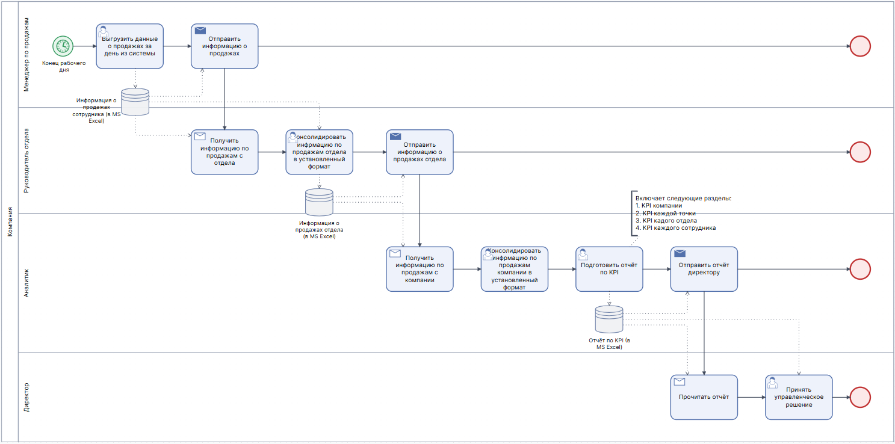
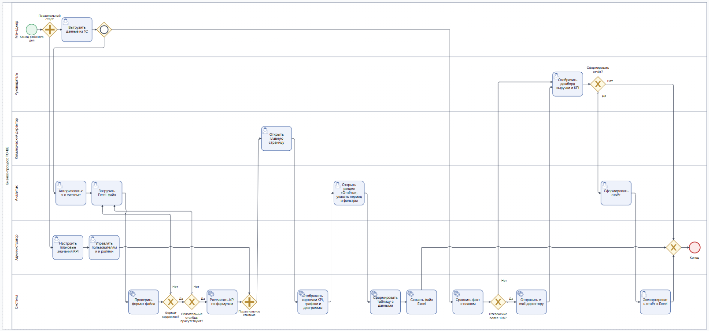

# Бизнес-требования — Business Metrics Analyzer

**Проект:** веб-приложение «Business Metrics Analyzer» для анализа KPI продаж
**Заказчик:** ООО «Ритейл-Аналитика», коммерческий директор
**Команда:** Мельситова Виолетта, Титов Роман, Осипенко Елизавета, Шипилов Александр

## 1. Исходные данные

### 1.1. Бизнес-процесс продаж

ООО «Ритейл-Аналитика» — средняя торговая компания: 12 торговых точек и интернет-магазин, около 40 менеджеров по продажам в 4 отделах.

1. Менеджер оформляет продажу в учётной системе (1С: Розница) — фиксируются чек, товары, сумма, скидка, точка продаж.
2. Данные о посетителях точек поступают из счётчиков посетителей, о посещениях интернет-магазина — из веб-аналитики.
3. В конце месяца аналитики выгружают данные из 1С в Excel, сводят их вручную, считают KPI и строят графики.
4. Готовый отчёт отправляется коммерческому директору и руководителям отделов по e-mail.
5. Подготовка отчёта занимает 2–3 рабочих дня, данные в нём устаревают к моменту получения.

### 1.2. Перечень основных метрик

| Метрика | Формула расчёта | Периодичность |
|---|---|---|
| Выручка | Σ всех чеков за период | День / неделя / месяц |
| Средний чек | Выручка / количество чеков | День / неделя / месяц |
| Конверсия | Количество чеков / количество посетителей × 100% | День / неделя / месяц |
| Рентабельность продаж | (Выручка − себестоимость) / выручка × 100% | Неделя / месяц |
| Количество новых клиентов | Число клиентов с первой покупкой в периоде | Неделя / месяц |
| Продажи по категориям товаров | Выручка в разрезе категорий, доля категории в общей выручке | Неделя / месяц |

### 1.3. Требования к безопасности и срокам

- Доступ к системе — только авторизованным сотрудникам, права зависят от роли.
- Менеджер видит только свои показатели, руководитель отдела — показатели своего отдела, коммерческий директор и аналитики — всю компанию.
- Данные о себестоимости и рентабельности — конфиденциальные, доступны только директору и аналитикам.
- MVP должен быть готов за 3 месяца (до начала нового финансового года).

## 2. Систематизация требований

### 2.1. Бизнес-требования

| ID | Требование | Источник | Приоритет |
|---|---|---|---|
| BR-01 | Обеспечить коммерческого директора и руководителей отделов продаж постоянным доступом к KPI-отчётам с ежедневно обновляющимися данными | Коммерческий директор | Must have |
| BR-02 | Сократить время принятия управленческого решения на основе отчёта с 3–5 дней до 5 минут | Коммерческий директор | Must have |
| BR-03 | Перейти с ручного построения графиков и сведения таблиц в Excel для составления отчёта по KPI на автоматическое формирование | Коммерческий директор | Must have |
| BR-04 | Разграничить показатели по ролям | Коммерческий директор | Should have |
| BR-05 | Дать менеджерам по продажам доступ только к собственным показателям | Коммерческий директор | Should have |
| BR-06 | Уведомлять на e-mail о падении выручки и/или конверсии более чем на 10% от установленного плана | Коммерческий директор | Could have |

### 2.2. Функциональные требования

| ID | Требование | Связанная User Story | Приоритет |
|---|---|---|---|
| FR-01 | Система должна отображать на главной странице карточки KPI (выручка, средний чек, конверсия, рентабельность) с индикатором изменения относительно прошлого периода | US-01 | Must have |
| FR-02 | Система должна строить линейные и столбчатые графики динамики KPI и круговые диаграммы структуры продаж по категориям товаров | US-01 | Must have |
| FR-03 | Система должна поддерживать фильтры по периоду, отделу, торговой точке / интернет-магазину и менеджеру | US-01, US-02 | Must have |
| FR-04 | Система должна формировать отчёт по KPI за выбранный период в виде таблицы, включая количество новых клиентов и продажи по категориям | US-02 | Must have |
| FR-05 | Система должна загружать данные о продажах и посетителях из Excel-файлов с проверкой формата и сообщением об ошибках. В будущем — автоматически из 1С | US-03 | Must have |
| FR-06 | Система должна экспортировать сформированный отчёт в формат Excel (.xlsx) | US-04 | Should have |
| FR-07 | Администратор должен иметь возможность создавать и блокировать учётные записи и назначать роли | US-05 | Should have |
| FR-08 | Система должна разграничивать доступ к данным по ролям: менеджер — свои данные, руководитель — свой отдел, директор и аналитик — вся компания; рентабельность — только директор и аналитик | US-05, US-06 | Should have |
| FR-09 | Администратор должен иметь возможность настраивать метрики и плановые значения KPI | US-07 | Could have |
| FR-10 | Система должна отправлять e-mail-уведомление при отклонении выручки или конверсии от плана более чем на 10% | US-08 | Could have |

### 2.3. Нефункциональные требования

| ID | Требование | Категория | Метрика |
|---|---|---|---|
| NFR-01 | Дашборд загружается и пересчитывает KPI при смене фильтров быстро | Производительность | ≤ 3 секунды |
| NFR-02 | Отчёт по KPI за месяц формируется быстро | Производительность | ≤ 15 секунд |
| NFR-03 | Данные актуальны | Актуальность данных | Обновление не реже 1 раза в сутки |
| NFR-04 | Доступ только после аутентификации | Безопасность | Передача данных по HTTPS; блокировка после 5 неудачных попыток входа |
| NFR-05 | Система доступна для работы в любое время | Надёжность | Доступность ≥ 99% |
| NFR-06 | Интерфейс понятен без обучения | Удобство использования | Новый пользователь формирует отчёт без инструкции за ≤ 10 минут |
| NFR-07 | Работа в современных браузерах на ПК | Совместимость | Chrome, Firefox, Edge, Яндекс.Браузер последних двух версий |

### 2.4. Ограничения

| ID | Ограничение | Описание |
|---|---|---|
| CN-01 | Срок | MVP должен быть сдан за 3 месяца |
| CN-02 | Бюджет | Без покупки коммерческих BI-лицензий — только open-source инструменты |
| CN-03 | Источник данных | Данные поступают только из Excel-файлов; интеграция с CRM и 1С не входит в текущий релиз |
| CN-04 | Платформа | Веб-приложение для браузеров на ПК; мобильная версия не входит в первый релиз |
| CN-05 | Законодательство | Обработка персональных данных сотрудников и клиентов в соответствии с 152-ФЗ «О персональных данных» |

## 3. Бизнес-процесс «как есть» (AS-IS)

1. **Выгрузка данных из 1С**
   - В конце дня сотрудник выгружает данные о продажах из 1С.
   - Сотрудник передаёт данные руководителю отдела.
2. **Составление сводных данных отдела**
   - Руководитель отдела собирает данные всех сотрудников.
   - Руководитель отдела форматирует данные в одну таблицу.
   - Руководитель отдела передаёт данные отдела аналитику.
3. **Составление сводных данных компании**
   - Аналитик получает данные всех отделов.
   - Аналитик форматирует их в одну таблицу.
4. **Формирование отчёта по KPI**
   - Аналитик рассчитывает KPI в табличном редакторе MS Excel.
   - Аналитик формирует дашборды в MS Excel.
   - Аналитик формирует отчёт по KPI для директора.
5. **Принятие управленческого решения**
   - Директор читает отчёт.
   - Директор принимает управленческое решение на основе полученной информации.

**Проблемы текущего процесса:** данные проходят три уровня ручной обработки в Excel, отчёт готовится 3–5 дней и к моменту получения устаревает, высок риск ошибок при сведении таблиц.

## 4. Бизнес-процесс «как будет» (TO-BE)

1. **Выгрузка данных из 1С**
   - В конце дня сотрудник выгружает данные о продажах из 1С.
2. **Загрузка данных в систему**
   - Аналитик авторизуется в системе.
   - Открывает страницу «Загрузка данных».
   - Загружает Excel-файл через интерфейс.
   - Система проверяет формат и наличие обязательных столбцов.
3. **Автоматический расчёт KPI**
   - Система автоматически рассчитывает метрики по заданным формулам.
4. **Просмотр дашборда KPI**
   - Коммерческий директор, руководитель отдела или менеджер открывает главную страницу.
   - На экране отображаются карточки KPI, графики и диаграммы.
   - Доступны фильтры по периоду, отделу, торговой точке / интернет-магазину и менеджеру.
   - KPI пересчитываются при смене фильтров не более чем за 3 секунды (NFR-01).
   - Каждый сотрудник видит только доступные ему данные: менеджер — только свои, руководитель отдела — только свой отдел, директор и аналитик — всю компанию.
5. **Формирование отчёта по KPI**
   - Аналитик (или директор, руководитель отдела) открывает раздел «Отчёты».
   - Указывает период и при необходимости фильтры (отдел, точка, менеджер).
   - Нажимает «Сформировать».
   - Система формирует таблицу с данными не более чем за 15 секунд (NFR-02).
6. **Экспорт отчёта в Excel**
   - Пользователь нажимает «Экспорт в Excel».
   - Система скачивает файл Excel.
7. **Уведомления об отклонении KPI от плана**
   - Администратор предварительно настраивает плановые значения KPI.
   - При загрузке данных система сравнивает фактические значения с планом.
   - Если выручка или конверсия падает ниже плана более чем на 10%, на e-mail коммерческого директора приходит письмо с уведомлением об отклонении.
8. **Настройка метрик и плановых значений**
   - Администратор открывает страницу «Настройка метрик».
   - Задаёт плановые значения.
   - Система проверяет корректность ввода.
   - На дашборде отдела рядом с фактической выручкой отображается план и процент его выполнения.
9. **Управление пользователями и ролями**
   - Администратор создаёт учётные записи: указывает ФИО, e-mail, отдел и роль.
   - На e-mail сотрудника отправляется ссылка для установки пароля.

**Результат изменений:** ручное сведение данных заменено загрузкой одного файла, расчёт KPI и визуализация выполняются автоматически, отчёт формируется за секунды, доступ к данным разграничен по ролям.
